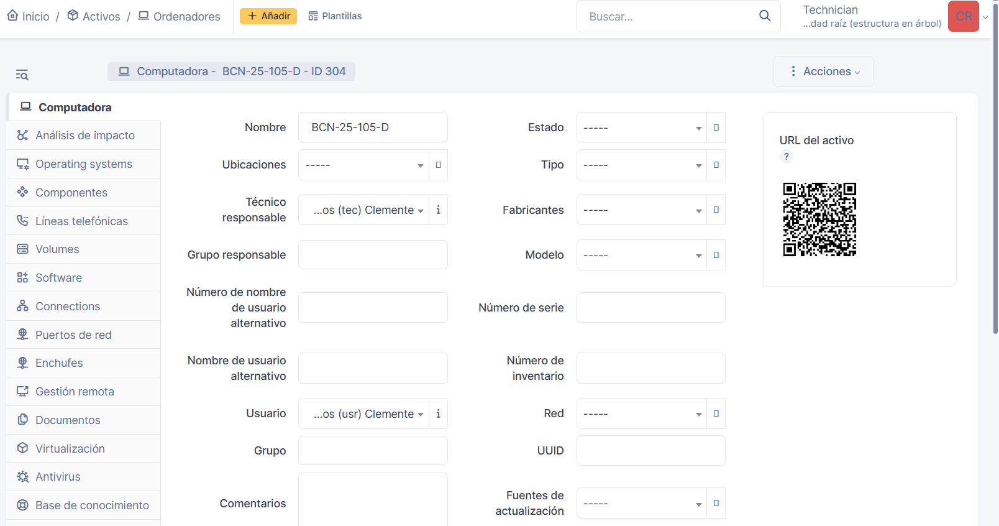
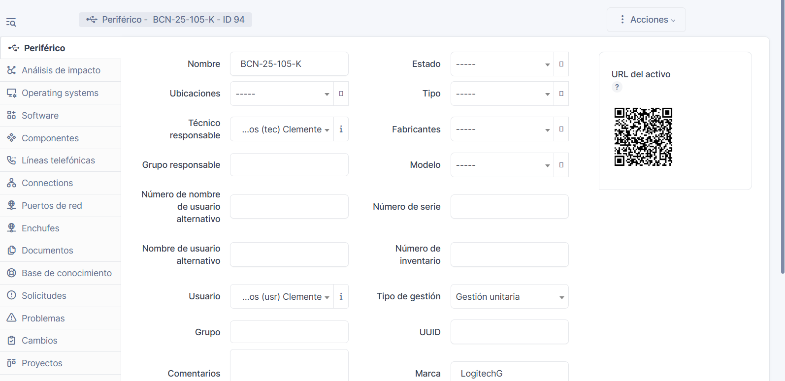
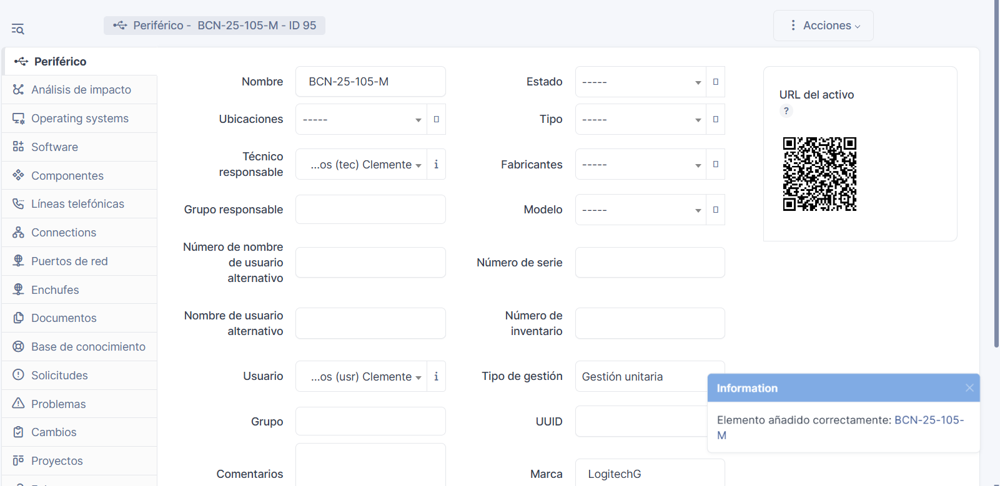
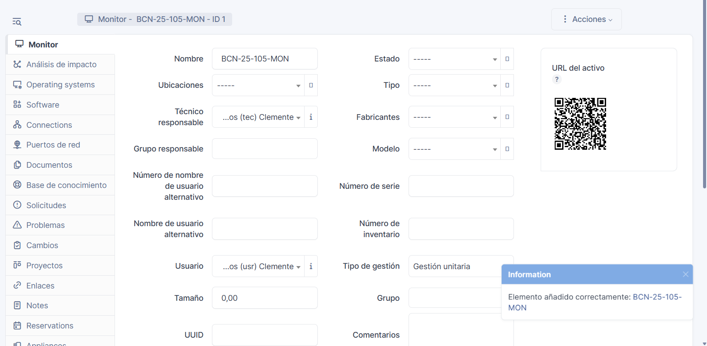
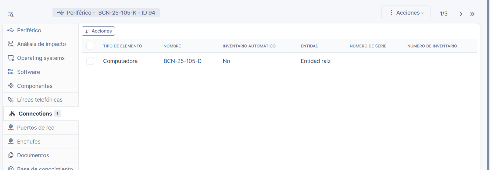
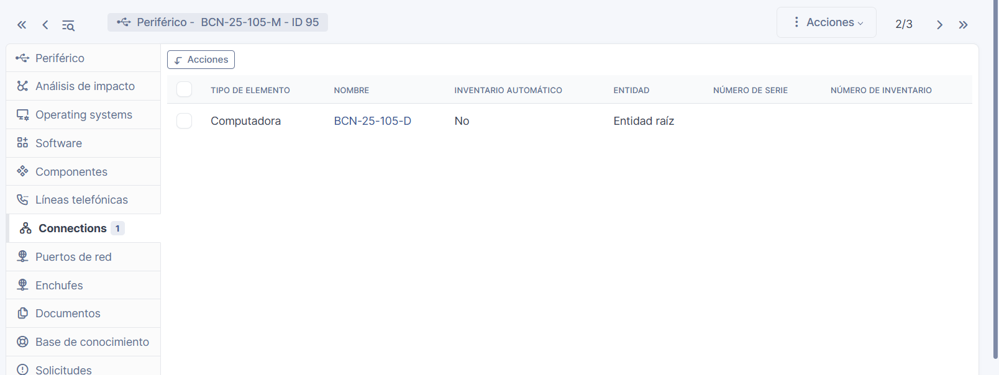
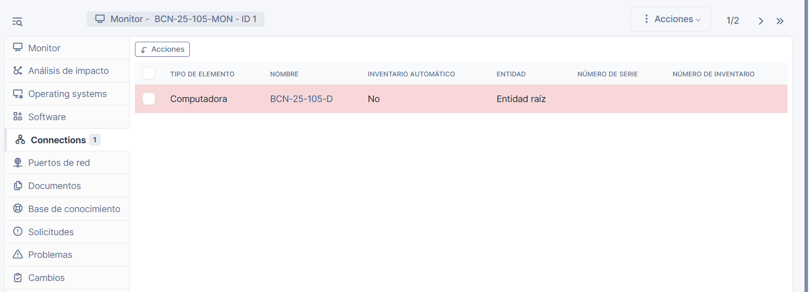
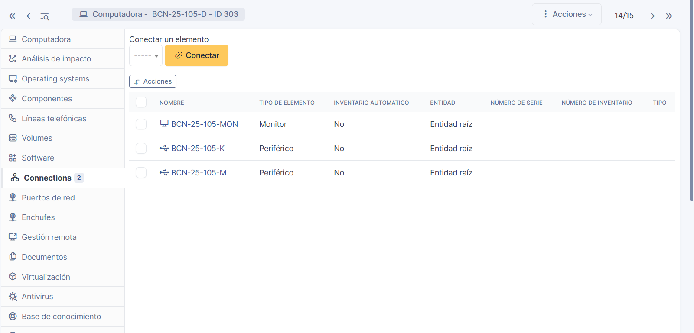
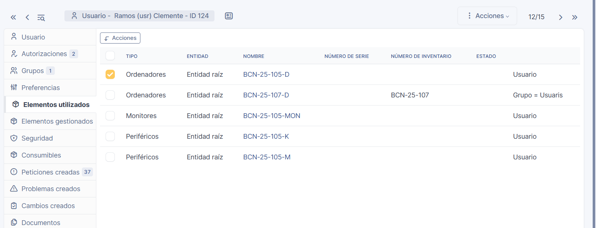

# Documentació GLPI

## 1. Descripció del procés

Per a l'alta del ordinador he anat al apartat de ordinadors on he creat un nou ordinador amb el nom BCN-25-106-D. On li he asignat el usuari meu en l'apartat de "usuario", com es veu en la **captura1**

Per a la conexió/relació amb els periferics al ordinador, primer he creat el periferic del teclat **captura2**, del ratolí **captura3** i després el del monitor **captura4**. On ha cadascún li he asignat el usuari i tecnic meu, perque ho pugui veure-hi desde el usuari també. 

I finalment, per poder connectar tots els periferics al ordinador asignat meu, ha cadascún dels periferics li he dit que es relacioni amb el ordinador BCN-25-106-D, com es pot veure en les captures: primer el del teclat: **captura5** , després el del ratolí: **captura6** i després el del monitor: **captura7**. Un cop fet tot aixó es queda aixins la relació dels periferics al ordinador: **captura8**

## 2. Captures de pantalla (recopilació)

* ordinador creat i asignat (captura1): 

* agregat teclat (captura2): 

* agregat ratolí(captura3): 

* agregat monitor(captura4): 

* asignat teclat(captura5)

* asignat ratolí(captura6)

* asignat monitor(captura7)

* tots els periferics asociats al ordinador(captura8): 

## 3. Esquema relacional

**Usuari (usr-clemente) ⟷ Ordinador(BCN-25-106-D) ⟷ Perifèrics (teclat, ratolí i monitor)**

* USUARI: L'usuari meu li he asignat al ordinador BCN-25-106-D: 
* ORDINADOR: Al ordinador li he asignat el usuari meu:  i també li he asignat els periferics: !
* PERIFERICS: Als periferics li he asignat al ordinador BCN-25-106-D: 

Tot es queda relacionat, perque quan hem registri amb el meu usuari usr-clemente trobi l'opció de reportar un problema al ticket amb el ordinador asignat.

## 4. Problemes trobats

Al principi no he sapigut com relacionar els periferics al ordinador però finalment he sapigut que es en l'opció de conectar i no de relacionar o enllaçar. He pogut relacionar o conectar els periferics als ordinador correctament després d'aquest inconvenient.

## 5. Propostes de millora

Reflexionar sobre:

- Com es podria millorar el procés
- Possibles automatitzacions
- Millores en la nomenclatura o organització

El procés de asociá els periferics als ordinador es podria fer de manera automatizada fent un promt que indiqui que aquell periferic es d'un ordinador o d'altre mitjançant amb una etiqueta o codi QR, perqué identifiqui que aquell periferic pertany a un ordinador amb un usuari concret.

També faria lo mateix amb els usuaris encara que sigui una mica més dificil, jo el tema dels usuaris ho deixaria tal com están. Que tú tinguis que asignat el ordinador al usuari peró que els components es quedin de manera que s'asignin sols mitjançant amb un promt en una dada de bases amb un QR.

I en l'organització posaria una etiqueta en el GLPI amb cada periferic per poder identificarlo mitjançant el QR que he dit abans. Perqué aixi per exemple si es trenca algún periferic, monitor o ordinador doncs sigui més fácil identificarlo.